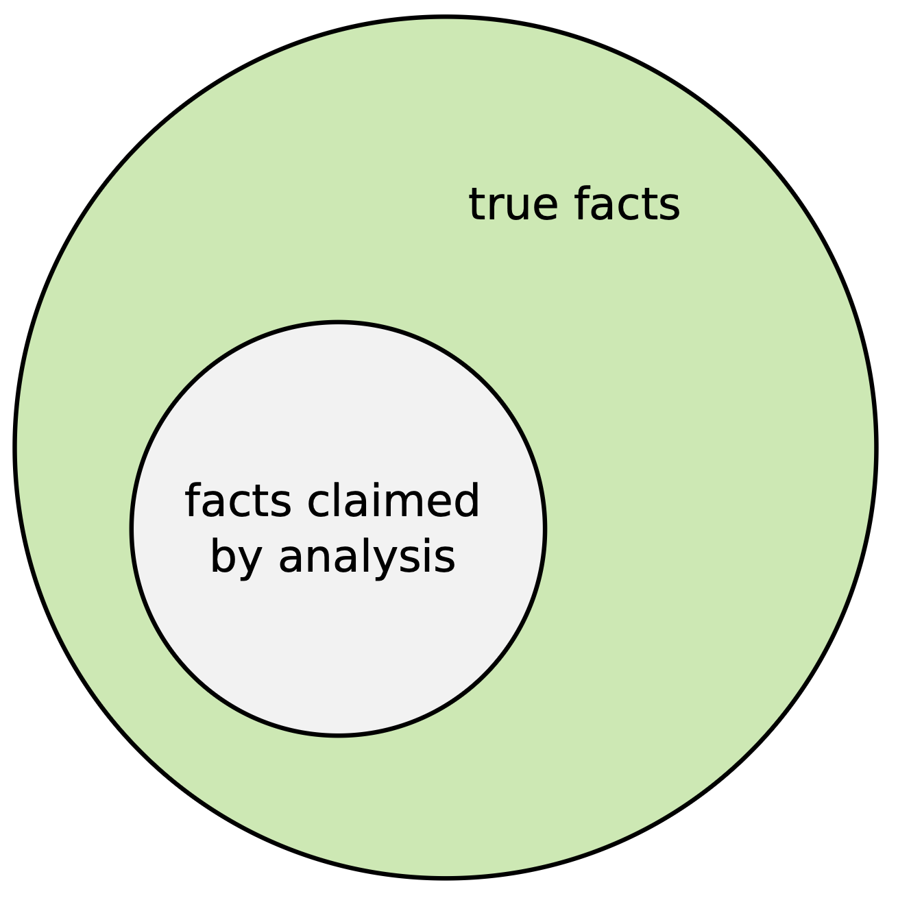
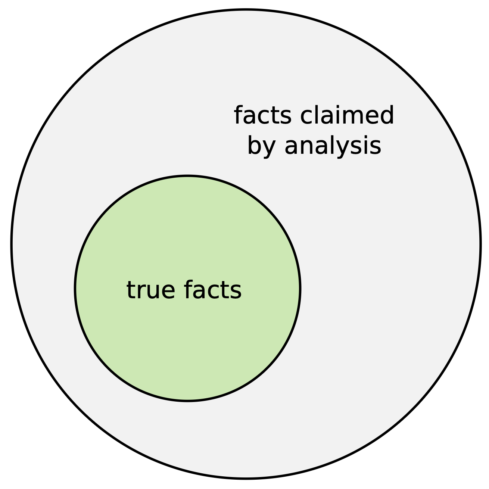
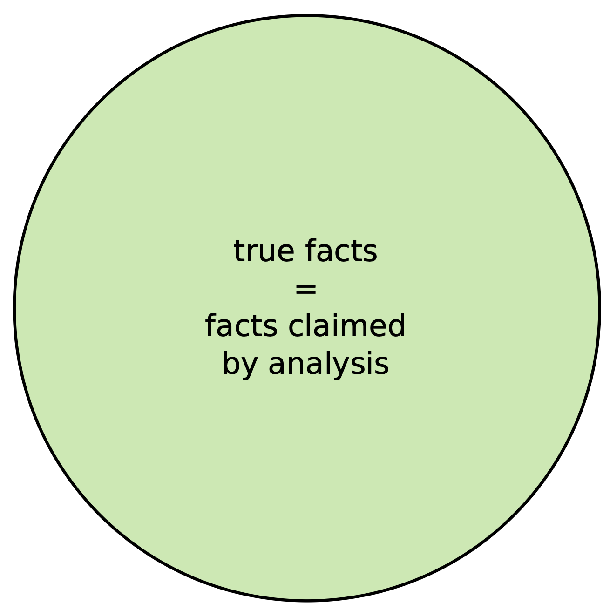
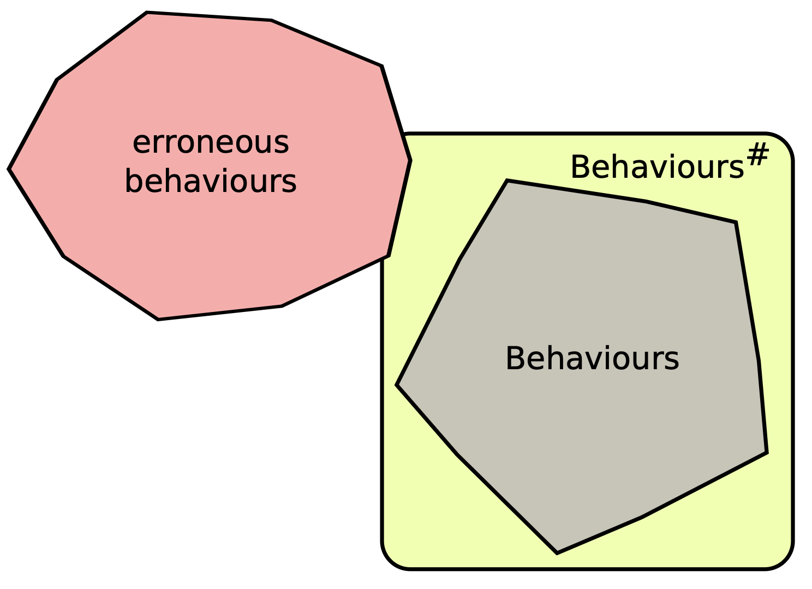
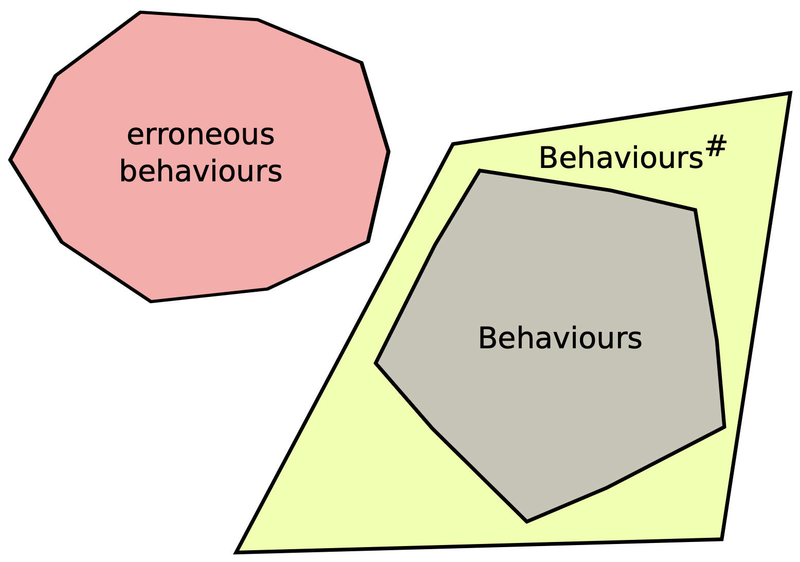
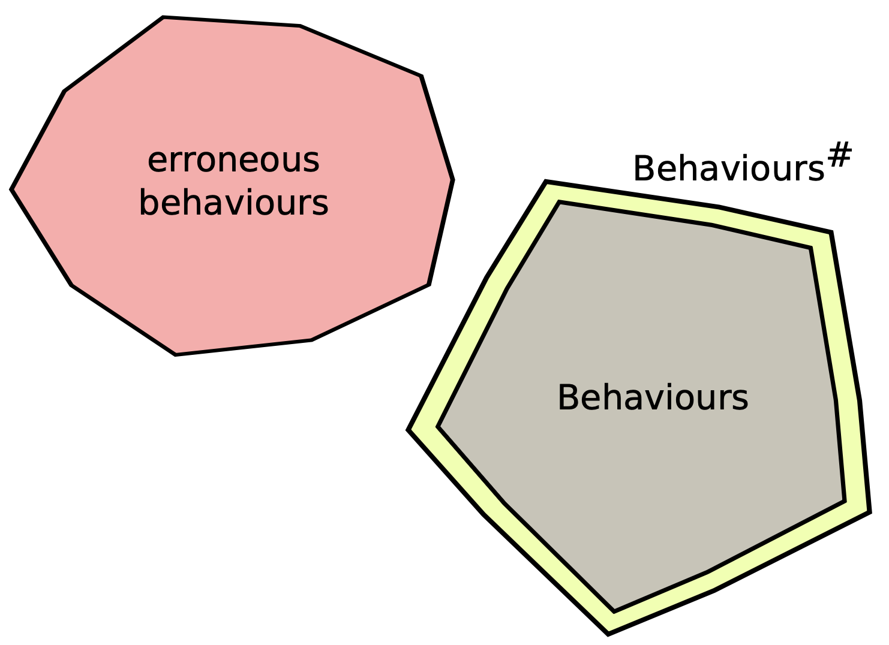
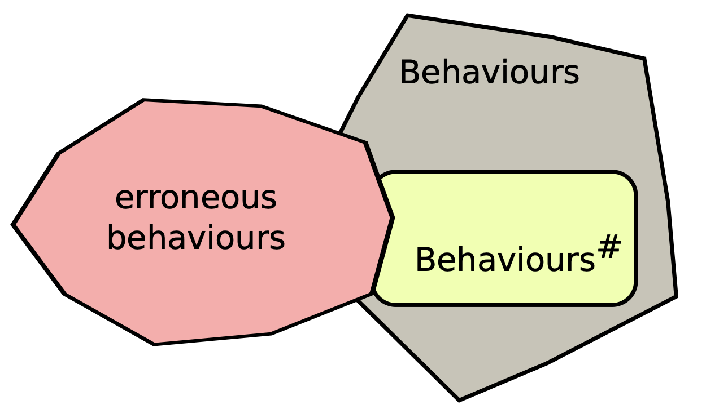

Many developers have come across the term "static analysis" and related ones such as "soundness" and "program semantics", but what they mean and how they fit together isn't always clear (or at least it wasn't to me).

This post introduces the basic terminology and the intuition behind it.
We start with what static analysis can offer and how it addresses the limitations
of testing and code auditing. We then explore its limits, why undecidability
makes approximation necessary, and the tradeoffs involved in designing useful
analyses, explaining concepts such as soundness, completeness and precision along the way.

This blog post is adapted from material in my [PhD thesis](https://danielefilaretti.com/assets/downloads/papers/Filaretti-D-PhD-2016.pdf), where you can find more
details if desired.

## The limitations of testing and code auditing

Common practices for software assurance are _testing_ and
code _auditing_.

At its core, testing consists of _running your program on a set of inputs_ and making
sure it behaves as expected.
When a test fails, a developer investigates the cause and fixes it before re-running the test
suite (perhaps adding more tests based on insights from debugging, improving confidence in the program's correctness).

The nice thing about testing is that if it finds a bug, then it's a real bug - there are no
false alarms!
The downside is that testing is _not exhaustive_: in general, no matter
how many tests are executed, testing will fail to explore all the possible
execution paths a program may take at runtime.

Code auditing essentially consists in convincing yourself
(or your client/boss/coworker) that the code is correct.
An obvious advantage over testing is that when reading code, humans can generalise, infer facts and make connections, which help them reason about multiple executions at once.

Like testing, however, code auditing can be time consuming and is, ultimately, still non exhaustive
(no matter how smart and focused the person reviewing the code is, there will always
be a chance of something being missed).

Now, this may or may not be a problem, depending on the application domain.
I'm no game developer, but I suppose if a bug causes a pixel on the screen to occasionally go black for a fraction of a second during a game,
well, that's perhaps no big deal. Or if a web page occasionally
doesn't load and the user has to refresh (provided no important data is lost!), it's no big deal either, I suppose.

In audio software, however,
that same kind of glitch can be unacceptable: even a single wrong
audio sample can cause a click (and trust me, nobody wants to hear that on stage
or in a recording). In a smart contract, a bug can be exploited to drain all funds in the protocol
(as has happened several times, with millions of dollars lost), and a bug in a website can leave it open to attacks that could expose or destroy users' data.

This should make it clear that in several domains, investigating techniques  to consider as many execution paths as possible
(or, indeed, all of them) can actually be pretty useful (and not just an academic exercise).

## Hello static analysis

_Static analysis_ is one such techniques.
It consists of analysing a program automatically, _without running it_.

In this, it resembles code auditing, but instead of
being performed by a human, the review is performed by a program, the static analyser.
This has an important advantage: static analysis is able to provide higher coverage than testing
and code auditing, and in some cases it can even explore _all possible execution paths_
in a program and  _guarantee_ the absence of errors.

If you think this sounds too good to be true, however, you're not wrong.
The benefits above, in fact, come with a price: static analysers can only check for limited (and generally
simple) properties; they may miss errors, issue false alarms, and they can also be time-consuming
and resource intensive. We'll explore this more
in the remainder of this post.

## The nature of static analysis (and its limitations)

A static analysis is an algorithm which takes a program as input and attempts to provide an
answer to a question about the set of its possible runtime behaviours
(often called its _semantics_). Typical questions include:

* is every user input sanitised before it flows into a sensitive sink?
* is every SQL query in the program constructed using only trusted input?
* is every array index in bounds?
* is every dereferenced pointer non-null?
* can division-by-zero occur?
* is this smart contract vulnerable to _reentrancy_ attacks?
* can funds get permanently locked in the smart contract?

Unfortunately, answering those questions exactly, automatically and for any program is _undecidable_.

To motivate this, we need to take a step back and consider the
"canonical" static analysis problem: the _halting problem_. Let `P` be an arbitrary program. Does `P`
terminate on all inputs? Can we design an algorithm that answers that question for any program?
Unfortunately, the answer is no: it can be shown that the existence of such an algorithm leads to logical
contradictions, and therefore we must conclude that
the algorithm itself cannot exist. I've written about this topic in a [previous blog post](https://danielefilaretti.com/Halting-Problem/) if
you'd like to know more.

Now, it is also possible to show that many interesting static analysis questions, including
the examples above, are _at least as hard as the halting problem_ and are therefore
undecidable too.

We won't go into the details here (you can find more in
chapter 4 of my [PhD thesis](https://danielefilaretti.com/assets/downloads/papers/Filaretti-D-PhD-2016.pdf)), but
the key idea is this: imagine we have such an analyzer
that is able to answer one of these
questions _exactly_ and  for any program, accounting for all possible inputs; then, it can be shown that
this analyzer could also
be used to solve the halting problem; in other words, the analysis and the halting problem are
somehow "equivalent in difficulty".
But since we already know that the halting problem cannot
be solved, then we must conclude that also our analysis cannot exist.

Shall we give up then? No!
Those limitations are just telling us that _exact_ static analysis is impossible, but there's still plenty of room for _useful_ static analysis.
By accepting some approximation and carefully navigating some key design tradeoffs, we can build analyses that are actually useful in
practice (althugh not exact/perfect).

## Design tradeoffs

So what does this approximation look like in practice?
It usually manifests itself as a combination of the following:

* the analyser might not terminate
* the analyser might raise false alarms (_false positives_)
* the analyser might miss errors and claim the program is "safe" when it’s not (_false
negatives_)

The undecidability results briefly discussed above say that there _must_ be some approximation;
as the analysis designers, what we can do is carefully tune the key aspects of the analysis algorithm in order to influence _how_ that approximation
manifests itself.

For starters,
non-terminating analyses are generally avoided for practical reasons (termination is
usually enforced by introducing a loss of information).
Then, we can also choose whether we want only false positives, only false negatives, or a combination of both.
Balancing false positives and false
negatives leads us to the concepts of _soundness_ and _completeness_, which we discuss next, together with another important tradeoff: _precision_ versus _scalability_.

### Soundness vs completeness

A _sound_ (or correct) static analysis proves true facts about the program semantics (intended as the
set of all possible runtime behaviours). For example, if a sound
analyser says that there are no out-of-bounds array accesses in the program, then the
user can be sure that the program will not exhibit out-of-bounds accesses at runtime.

In general, if a sound analysis says property P is true about a program’s semantics, then P is actually
true. However, the fact that P is true does not necessarily imply that
the analysis claims it is true. For example, a program might be free from division-by-zero
errors (in the sense that there is no execution path that leads to a division where the denominator
is zero) but the analysis might fail to discover that and instead raise a _false alarm_.

{: width="350" style="display: block; margin-left: auto; margin-right: auto;"}

On the other end of the spectrum are _complete_ analyses. If
property P about the semantics of the program is true, a complete analysis claims that P is true.
For example, if the program is free from index-out-of-bounds errors, then the analysis will be able
to detect it, and therefore there are no false alarms. On the other hand, if the analysis says property P is true, there is no guarantee that it will be true. In other
words, a complete analysis might _miss errors_.

{: width="350" style="display: block; margin-left: auto; margin-right: auto;"}

In summary, if a sound analysis finds a bug, it might be a false alarm, but if it
claims the program is error-free, then it must be error-free. With a complete analysis,
if it claims the program is safe, that might not be true, but if it finds a bug, then that bug
must be real.

Finally, a _sound and complete_ analysis is able to verify the absence of errors
without producing false alarms.
A property P about a program holds if and only if the analysis claims the fact.

{: width="350" style="display: block; margin-left: auto; margin-right: auto;"}

However, realising a sound and complete analyser
would amount to solving the halting problem and therefore is impossible!

In practice, sound analyses
are used when the primary goal is guaranteeing the _absence of bugs_ (for example in critical
embedded applications), while complete analyses are used when the priority is on _finding real bugs_
(such as in non-critical application development).

Many interesting analyses try to reach the sweet
spot of finding many bugs with few false positives by being neither sound nor complete.

### Precision vs scalability

Another design tradeoff in static analysis is between _precision and scalability_. A precise analysis
models program behaviour very closely in order to reduce the number of false alarms (in the case of
a sound analysis) or to reduce the number of missed bugs (in the case of a complete analysis). A
scalable analysis is able to analyse large codebases within reasonable time and space resources.

Unfortunately, very precise analyses tend to have greater algorithmic complexity, making them
less efficient and less scalable (think about it: the most precise analysis of all would be... executing the actual program on all inputs, which isn’t feasible in practice). On the other hand, a very efficient analysis may be less
precise, producing more false positives (or negatives).

Again, we cannot achieve absolute precision for every program.
If we increase the precision of a
sound analysis we reduce the number of false positives. However, we also get progressively closer to
a sound analysis which does not produce any false positives, which is undecidable.

Similarly, if we
progressively increase the precision of a complete analysis we’ll end up catching exactly all real
bugs and therefore we’ll have obtained, again,  an undecidable analysis.

Balancing these tradeoffs is part art and part science, and the right
combination also depends on the particular language being analysed, its usage and the average
size of programs in the chosen application domain.

But, ultimately, what is a static analyzer trying to do? We provide an intuition next.

## Approximating the set of _all_ possible runtime behaviours

Imagine we could run a program on every possible combination of inputs and record every
state visited during every execution. The set of all these reachable states is usually referred to as the
_collecting semantics_ of the program.

Suppose we now wanted to check that the program never divides by zero or accesses an array out of
bounds. In principle, we could just inspect every state in this set and report an alarm if any of
them exhsibits the "bad behaviour". If none does, the program is safe with respect to the
property we are checking.

The catch, as we saw earlier, is that a program may have infinitely many inputs and executions
that never terminate. Computing its collecting semantics exactly is therefore impossible in
general. Instead, static analysers attempt to compute a suitable _approximation_ (which we call the _abstract semantics_) and then compare it with (a representation of) the set of erroneus states.

If the intersection between those two
sets is empty, the program is considered safe. Otherwise the analyser reports a warning. In this
setting, the notions of soundness, completeness, false positives and false negatives can be understood in terms of _overapproximation_ and _underapproximation_ of the program semantics.

A sound analysis computes an _overapproximation_, that is a superset of the program semantics, as
shown intuitively in this diagram:

{: width="350" style="display: block; margin-left: auto; margin-right: auto;"}

Here, the _abstract semantics_ `Behaviours#` (i.e. the set of program behaviours calculated by the static analyser) intersects the set of erroneous
behaviours, so the analysis produces an alarm. However, it is a false alarm, since the
actual program semantics, `Behaviours`, is disjoint from the "erroneous zone". The analysis had
considered a spurious behaviour, one the program will never exhibit
at runtime.

Increasing precision can be understood as building a "better" and "smaller" approximation of
`Behaviours`, still a superset of it but "small enough" to avoid intersecting the dangerous zone:

{: width="350" style="display: block; margin-left: auto; margin-right: auto;"}

In this case, the analysis has proved the program safe with no
false alarms.

But, as seen before, precision needs to be traded off with scalability.
In this last example, the approximation was still coarse enough to be easily
computable (intuitively expressed by the simple shape of `Behaviours#`) yet it was
precise enough to prove the property of interest
without false alarms.

Intuitively, we could now make the abstraction even more precise:

{: width="350" style="display: block; margin-left: auto; margin-right: auto;"}

but that would likely make the analysis less efficient while providing little advantage: the coarser
abstraction of the previous figure was already "good enough"
(and much simpler to calculate).

In other
words, sometimes _the cost of a more precise abstraction outweighs the benefits_. The goal is
to design an abstraction coarse enough to be easily computed while being
precise enough to minimise false positives for the property
and domain being analysed.

Dually, complete analyses can be understood as underapproximations, that is subsets, of the
program semantics:

{: width="350" style="display: block; margin-left: auto; margin-right: auto;"}

Note that in this case, there is no possibility
for false alarms, since `Behaviours#` is a subset of `Behaviours` which is the set of actual program
behaviours. However, for the very same reason, the analysis might miss real bugs.

To improve a complete analysis, we need to capture more behaviours. However, capturing more behaviours generally makes the analysis less efficient and less scalable.
The same considerations about overapproximating analyses apply to underapproximating
analyses.

## So which tradeoff should we choose?

We should point out that sound analyses are not necessarily better than
unsound ones.

Sound and complete analyses have distinct applications. When
the goal is to prove a program safe, then a sound analysis is appropriate, and the time spent
dealing with false positives may be worth it (e.g. when
analysing a smart contract that will hold millions).

However, in less critical settings
where the focus is on actually finding bugs, missing some bugs may be acceptable
and actually more desirable than a large number of false positives.

Ultimately,
analyses might be neither sound nor complete, instead relying on delicate tradeoffs between false
positives and false negatives to achieve the sweet spot for a particular domain.
